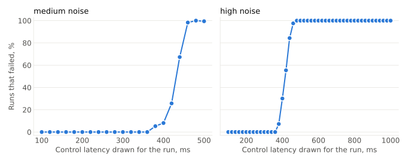
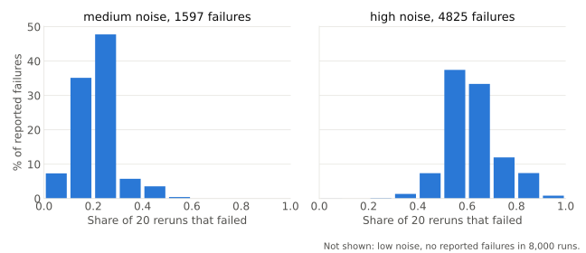
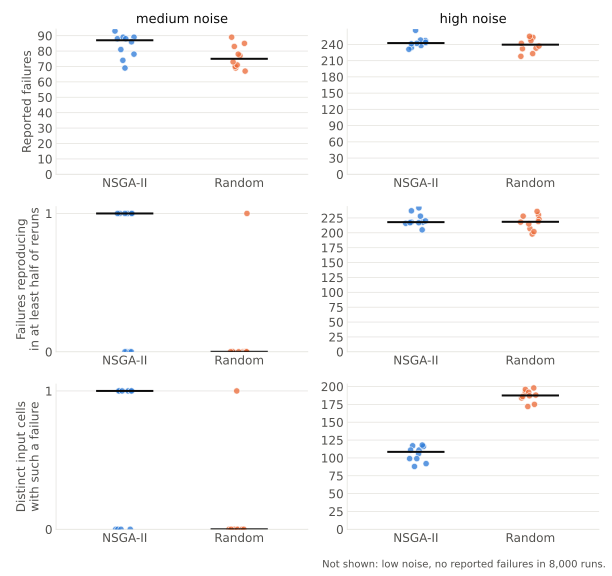
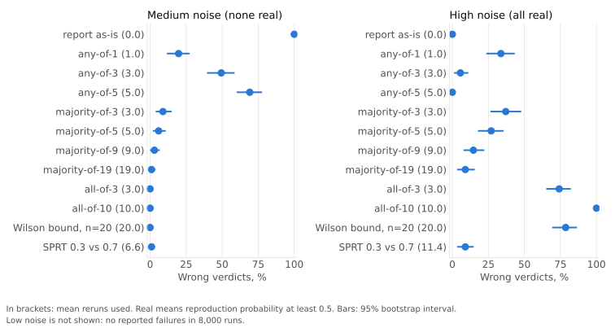

# First result: campaign v1 (2026-11-10)

**Bottom line.** The campaign ran as planned, but it cannot answer which verdict rule separates real failures from spurious ones. Control latency decides almost every outcome and the scenario hardly matters, so reported failures at one noise level all have nearly the same reproduction rate. The verdict-rule tables below therefore show how each rule behaves at two base rates, about 0.2 and 0.63. A corrected design is needed before any rule can be recommended.

The plan and frozen ranges are in `docs/PREREG.md` and `docs/CALIBRATION.md`. In total 196,840 runs took 2 h 2 min on 4 CPU cores: 24,000 search and random evaluations, 128,440 replication runs and 44,400 reference runs. The code commit is `5d1b9b1`, clean at launch. Raw logs are in `results/raw/campaign_v1`, which git ignores.

## What decides a failure

Added after seeing the results, and not in the plan. No run failed below 380 ms of latency at medium or high noise. From 460 ms at least 97% failed. Medium noise allows up to 500 ms, high noise up to 1000 ms and low noise only 160 ms, which is why low noise produced no failures.

| Predicting one run's failure, cross-validated AUC, random arm | Medium | High |
|---|---|---|
| Scenario inputs only | 0.526 | 0.501 |
| Latency only | 0.989 | 0.998 |
| Gust timing only | 0.499 | 0.503 |

The range calibration targeted a random failure rate of 5% to 20% and never checked what caused the failures. The 18.2% it reached is almost entirely the share of medium-noise runs that drew a latency past the cliff. That check should have been part of the calibration.

## Reproduction rates

| | Low | Medium | High |
|---|---|---|---|
| Random arm: failed runs | 0 of 4,000 | 762 of 4,000 (19.1%) | 2,391 of 3,834 (62.4%) |
| Reported failures, both arms | 0 | 1,597 | 4,825 |
| Mean share of 20 reruns that failed | n/a | 0.201 | 0.629 |
| Reported failures reproducing in at least half of reruns | n/a | 0.4% | 91.1% |
| Never reproduced in 20 reruns | n/a | 1.3% | 0% |
| Reproduced in all 20 reruns | n/a | 0% | 0.04% |
| Reference p̂ (200 runs per failure): mean, range | n/a | 0.199, 0.085 to 0.300 (120 failures) | 0.632, 0.556 to 0.721 (101 failures) |
| Spread of p̂: observed sd, sd if all failures were identical | n/a | 0.044, 0.028 | 0.038, 0.034 |

Each mean reproduction rate is close to that level's base failure rate, so a reported failure says almost nothing about its scenario. The medium level shows slight real variation between failures (dispersion 1.09, p = 0.006). The high level shows none (dispersion 1.00, p = 0.43). With 0 failures in 4,000 random runs, the low-noise failure rate is below 0.075% at 95% confidence.

## Search against random

Medians over 10 seeds, 400 evaluations each. A12 above 0.5 favours NSGA-II.

| Level | Measure | NSGA-II | Random | A12 | p |
|---|---|---|---|---|---|
| Low | Reported failures | 0 | 0 | n/a | n/a |
| Medium | Reported failures | 87 | 75 | 0.76 | 0.053 |
| Medium | Reproducing in at least half of reruns | 1 | 0 | 0.75 | 0.025 |
| Medium | Distinct input cells | 1 | 0 | 0.75 | 0.025 |
| High | Reported failures | 242.5 | 239.5 | 0.57 | 0.62 |
| High | Reproducing in at least half of reruns | 218 | 218.5 | 0.57 | 0.65 |
| High | Distinct input cells | 108.5 | 187.5 | 0.00 | 0.0002 |

At high noise search is no better than random at finding failures and covers fewer input cells, because failures there do not depend on the inputs and NSGA-II concentrates its samples. The medium-noise advantage comes from 6 failures against 1 and is not corrected for multiple tests. At low noise search did get closer to failure: its smallest margin was 0.079 m against 0.176 m for random, and its 5th percentile 0.166 m against 0.360 m. That is the only level where the scenario clearly drives the outcome, and no run crossed the lane edge.

## Verdict rules

Real means p ≥ 0.5 by the reference runs. Weighted over strata, with 95% bootstrap intervals over failures. At this threshold no medium-noise failure is real and every high-noise failure is real, so "wrong" means a false confirmation at medium and a false rejection at high.

| Rule | Medium: wrong verdicts, % | Reruns | High: wrong verdicts, % | Reruns |
|---|---|---|---|---|
| Report as-is | 100 (100 to 100) | 0 | 0 (0 to 0) | 0 |
| Any-of-1 | 19.7 (11.6 to 27.4) | 1 | 33.7 (23.6 to 43.3) | 1 |
| Any-of-3 | 49.4 (39.5 to 58.6) | 3 | 5.6 (1.1 to 11.1) | 3 |
| Any-of-5 | 69.1 (60.0 to 77.7) | 5 | 0 (0 to 0) | 5 |
| Majority-of-3 | 8.9 (3.8 to 14.9) | 3 | 37.1 (26.4 to 47.8) | 3 |
| Majority-of-5 | 5.9 (1.9 to 10.9) | 5 | 27.0 (17.8 to 35.6) | 5 |
| Majority-of-9 | 3.0 (0 to 6.7) | 9 | 14.6 (7.8 to 22.2) | 9 |
| Majority-of-19 | 1.0 (0 to 3.8) | 19 | 9.0 (3.4 to 15.6) | 19 |
| All-of-3 | 0 (0 to 0) | 3 | 74.1 (65.2 to 82.2) | 3 |
| All-of-5 | 0 (0 to 0) | 5 | 93.2 (87.8 to 97.8) | 5 |
| All-of-10 | 0 (0 to 0) | 10 | 100 (99.9 to 100) | 10 |
| Wilson bound, n = 20 | 0 (0 to 0) | 20 | 78.6 (69.3 to 86.5) | 20 |
| SPRT 0.3 vs 0.7, α = β = 0.05 | 1.0 (0 to 3.3) | 6.6 | 9.0 (3.4 to 14.8) | 11.4 |

- Replication need: majority-of-7 reaches at most 5% wrong at medium noise. No majority rule up to 19 reaches it at high noise, where p is close to the 0.5 threshold.
- Only majority-of-19 and the sequential test stay at or below about 9% wrong at both levels. The sequential test does so with 6.6 and 11.4 reruns on average, against 19. It is the one rule worth carrying forward.
- Its stated 5% error applies only outside 0.3 to 0.7. High-noise failures sit at p ≈ 0.63, inside that band, and the 9% there is consistent with that.
- Any-of and all-of rules are good at one level only, because each is biased in one direction.
- Results at the sensitivity thresholds are in `results/verdict_rules.csv`. At τ = 0.2 medium-noise failures straddle the threshold by sampling noise alone, so those rows are not informative.

## Departures from the plan and other limits

- Low noise had no failures, so replication and rule analysis were impossible there. The analysis code was changed to handle this case.
- Added after seeing the results: the latency diagnostic (`src/stp/diagnostics.py`, logged data only), the margin and gate summaries, and plotting wrong verdicts only.
- At high noise 239 of 8,000 evaluations (3.0%) and 2,481 of 96,500 reruns (2.6%) failed realisation, on `road_arc1` and `reached_curve`, and got no verdict. High-noise failure rates are slightly understated for that reason.
- At high noise 12 of the 102 failures sampled for reference runs were left out of the rule analysis, because fewer than 19 of their reruns were realised.
- Truth comes from 200 reference runs per failure, so a failure with p close to τ can be mislabelled.
- Reproduction measures injected randomness only, in one simulator, one scenario family and one simple controller. It says nothing about real driving stacks.

## Next

Rerun with latency removed as the dominant cause, for example fixed for the system or kept below 360 ms. Vary perception noise and gust timing per level. Before freezing, require on random samples that scenario inputs predict outcomes (AUC well above 0.5), so that reported failures can differ from one another. A verdict rule can only be judged once some failures are real and others are not at the same noise level.
