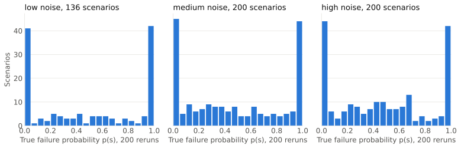
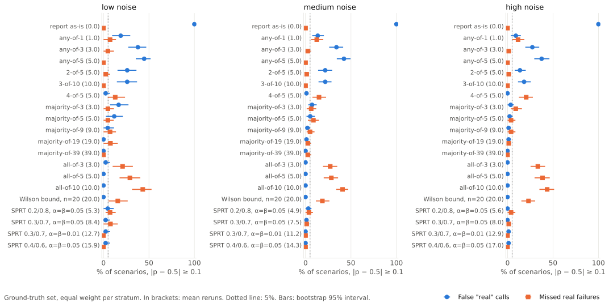
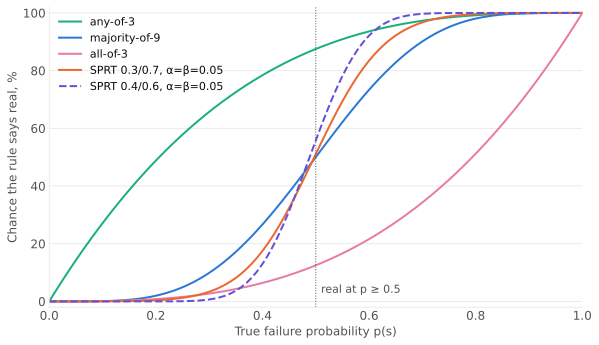
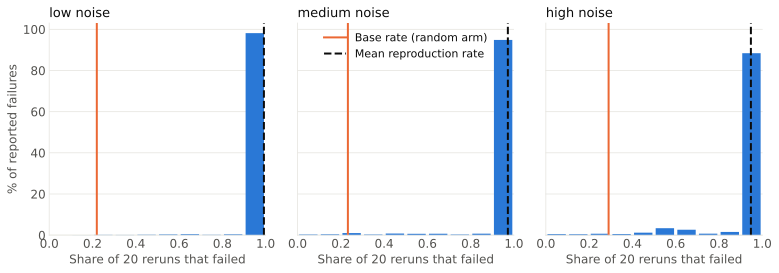
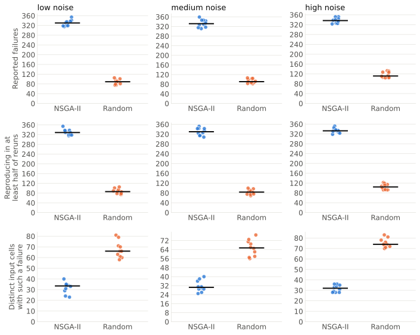
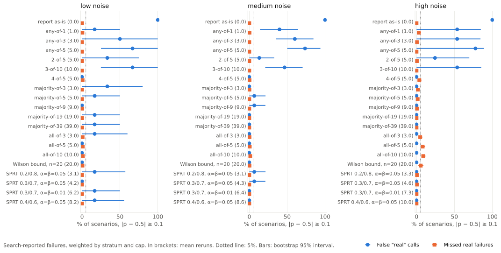

# Campaign v2: verdict rules scored against ground truth

**Bottom line.** With control latency fixed at 200 ms, the scenario decides whether a run can fail, so verdict rules can be judged at last. A reported failure is now far more likely to reproduce than a random run is to fail. At the 0.5 threshold, a sequential test (SPRT 0.2/0.8, α = β = 0.05) gets 3% to 4% of clear-cut cases wrong in each direction for about 5 reruns, at all three noise levels. Any-of rules call too many failures real and all-of rules miss too many. No affordable rule resolves a failure within 0.1 of the threshold. All of this is injected noise in one simple simulator setup.

The plan and its one post hoc amendment are in `docs/v2/PLAN.md`, and the frozen space in `docs/v2/CALIBRATION.md`. In total 373,452 runs were made: 21,600 gate, 164,640 ground-truth and 187,212 search. The campaign took 3 h 7 min on two workers, from clean commit `a9aaccd`. Every run in every stage was realised.

## What v1 showed

v1 (tag `v1-noise-dominated`, "v1: noise-dominated, cautionary result", `docs/REPORT.md`) drew control latency per run. Latency decided almost every outcome, so all failures at one noise level shared one reproduction probability, close to the base rate. Rules could only be seen at two base rates, and v1 could not say which rule to use.

| | v1 (medium, high noise) | v2 (low, medium, high noise) |
|---|---|---|
| AUC for failure from scenario inputs | 0.526, 0.501 | 0.993, 0.979, 0.967 (fresh confirmation sample) |
| Random-arm failure rate (base rate) | 19.1%, 62.4% | 22.0%, 23.3%, 29.0% |
| Mean reproduction of reported failures | 0.201, 0.629 | 0.992, 0.972, 0.947 |
| Dispersion of rerun counts (1 = all alike) | 1.09, 1.00 | 10.2, 12.5, 10.1 |

## Gates

Candidate A (speed 8–24 m/s, curvature up to 0.020 1/m, gust up to 1.0 m/s) was first in the planned order and passed every gate, so no other candidate was tried. The first latency check failed. Its design limited curvature but not gust, and every failure at 300 ms or below had gust above 0.75 m/s. **Post hoc amendment**, approved by the author before rerunning: the check was repeated on fresh scenarios with gust 0. It then showed no failures at any level up to 360 ms, so 200 ms sits below the failure point. Gust timing alone stays near chance (AUC 0.50 to 0.54).

## Hypotheses

| | Stated in advance | Result |
|---|---|---|
| H1 | Scenario inputs predict failure at each level | Supported, AUC 0.967 to 0.993 |
| H2 | Reported failures at one level differ | Supported, dispersion 10 to 12.5, p < 0.001 |
| H3 | Reproduction exceeds the base rate | Supported at every level, by 0.66 to 0.77 |
| H4 | Reproduction falls, partial reproduction rises, with noise | Supported, 0.992 → 0.972 → 0.947 and 2.3% → 5.8% → 12.5% |
| H5 | Any-of makes false "real" calls, all-of misses | Supported, see below |
| H6 | SPRT 0.3/0.7 uses fewer reruns than a fixed majority of equal or lower error | Supported, 7.5 to 8.4 reruns against 19 to 39 |
| H7 | NSGA-II finds more confirmed failures than random | Supported on counts, but with half the input-cell spread |

## Ground truth

For each level, candidates came from 600 random scenarios and bisection probes. Each was piloted with 10 reruns and stratified by pilot rate. Selected scenarios got 200 truth reruns and, on an independent seed stream, 40 rule reruns.

Medium and high noise each filled all 200 scenarios. Low noise reached 136, because only 21, 19 and 16 candidates fell in the three middle strata. The plan's rule is to report a shortfall and not top it up. Few scenarios at low noise have intermediate probability.

## Verdict rules against ground truth

"Real" means p ≥ 0.5. The table covers scenarios at least 0.1 from that threshold, with strata weighted equally. That mix is a design choice and not an estimate of any population. Percentages are false "real" calls / missed real failures.

| Rule | Low | Reruns | Medium | Reruns | High | Reruns |
|---|---|---|---|---|---|---|
| any-of-3 | 37.8 / 4.8 | 3 | 34.0 / 2.5 | 3 | 27.3 / 1.3 | 3 |
| all-of-3 | 2.3 / 20.9 | 3 | 0 / 27.2 | 3 | 0 / 33.3 | 3 |
| majority-of-5 | 11.8 / 4.8 | 5 | 5.2 / 8.6 | 5 | 2.3 / 3.8 | 5 |
| majority-of-9 | 4.6 / 7.2 | 9 | 2.1 / 4.9 | 9 | 1.1 / 3.8 | 9 |
| majority-of-19 | 0 / 7.6 | 19 | 1.0 / 2.5 | 19 | 1.1 / 1.3 | 19 |
| Wilson bound, n = 20 | 0 / 15.7 | 20 | 0 / 18.5 | 20 | 0 / 23.1 | 20 |
| SPRT 0.2/0.8, α = β = 0.05 | 4.6 / 7.2 | 5.3 | 3.1 / 3.7 | 4.9 | 0 / 3.8 | 5.6 |
| SPRT 0.3/0.7, α = β = 0.05 | 2.3 / 7.6 | 8.4 | 1.0 / 1.2 | 7.5 | 0 / 1.3 | 8.0 |
| SPRT 0.3/0.7, α = β = 0.01 | 2.3 / 0 | 12.7 | 0 / 0 | 11.2 | 1.1 / 0 | 12.9 |
| SPRT 0.4/0.6, α = β = 0.05 | 2.3 / 0 | 15.9 | 0 / 0 | 14.3 | 1.1 / 0 | 17.0 |

Intervals are in `results/v2/verdict_rules.csv` and on the figure. They are wide at this sample size, typically a few percentage points each side and up to about 10.

**Near the threshold.** Within 0.1 of τ = 0.5 (14, 22 and 34 scenarios) every rule tested was wrong about 26% to 65% of the time. These cases are effectively coin flips at this budget.

**Stated against achieved error, exact calculation with the 40-rerun cap.**

| Sequential test | Stated α, β | False "real" at p0 | Missed at p1 | Mean reruns at p0 | Worst mean reruns |
|---|---|---|---|---|---|
| 0.2/0.8 | 5% | 1.5% | 1.5% | 4.8 | 9.0 |
| 0.3/0.7 | 5% | 3.3% | 3.3% | 9.3 | 15.3 |
| 0.3/0.7 | 1% | 1.0% | 0.7% | 14.7 | 26.7 |
| 0.4/0.6 | 5% | **12.9%** | **7.9%** | 28.6 | 33.6 |

The cap breaks the narrow test's guarantee: 0.4/0.6 needs more than 40 reruns to meet its stated 5%.

## Which rule, under which noise

**By the criterion fixed in the plan** (at most 5% false "real" and 5% missed, at least 0.1 from τ, fewest mean reruns):

| Threshold | Low noise | Medium noise | High noise |
|---|---|---|---|
| τ = 0.5 | SPRT 0.3/0.7, α = β = 0.01, 12.7 reruns | SPRT 0.2/0.8, 4.9 reruns | majority-of-5, 5.0 reruns |
| τ = 0.2 | any-of-5, 5.0 | SPRT 0.05/0.35, 6.6 | SPRT 0.05/0.35, 6.2 |
| τ = 0.8 | all-of-5, 5.0 | all-of-3, 3.0 | all-of-3, 3.0 |

These choices rest on one rerun sequence per scenario, so small differences between rules are noise. The planned secondary score, the exact verdict probability given each scenario's estimated p, removes that noise. At τ = 0.5 it picks **SPRT 0.2/0.8 at all three levels** (4.8 to 5.1 expected reruns). It also rejects majority-of-5 at high noise (5.6% / 7.5%). At τ = 0.8 it prefers all-of-5 or SPRT 0.65/0.95 to all-of-3.

**Practical reading (post hoc, not in the plan).** Use SPRT 0.2/0.8 with α = β = 0.05 as the default at τ = 0.5, at any of these noise levels. Use SPRT 0.3/0.7 with α = β = 0.01, about 12 reruns, when failures within roughly 0.1 to 0.3 of the threshold matter. Do not use any-of or all-of rules at τ = 0.5, and do not treat a verdict within 0.1 of the threshold as settled.

## Search campaign

| | Low | Medium | High |
|---|---|---|---|
| Reported failures, NSGA-II / random | 3,298 / 880 | 3,327 / 931 | 3,369 / 1,160 |
| Base rate, random arm (95% interval) | 22.0% (20.7–23.3) | 23.3% (21.9–24.5) | 29.0% (27.5–30.4) |
| Mean reproduction rate, all reported | 0.992 | 0.972 | 0.947 |
| NSGA-II / random arm | 0.996 / 0.978 | 0.991 / 0.905 | 0.980 / 0.852 |
| Reproduced in every one of 20 reruns | 97.7% | 94.2% | 87.2% |
| Reproduced partly | 2.3% | 5.8% | 12.5% |
| Real at τ = 0.5, by reference runs | 99.6% | 96.9% | 97.6% |

Medians over 10 seeds at 400 evaluations. A12 above 0.5 favours NSGA-II. All nine p-values are 0.002 after Holm correction.

| Measure | Low | Medium | High |
|---|---|---|---|
| Reported failures | 330 vs 89 (A12 1.0) | 332 vs 91 (1.0) | 337 vs 112 (1.0) |
| Reproducing in at least half of reruns | 328 vs 86 (1.0) | 330 vs 84 (1.0) | 333 vs 104 (1.0) |
| Distinct input cells | 34 vs 66 (0.0) | 31 vs 66 (0.0) | 32 vs 74 (0.0) |

NSGA-II finds about four times as many failures as random, but in half as many input cells. Search concentrates on one region. Cells are counted on the up to 100 failures per seed that were replicated, which may understate NSGA-II slightly. Random's counts are close to complete.

**Rules on reported failures.** Because almost every reported failure is real, accepting them as they stand is wrong only 0.4%, 3.1% and 2.4% of the time at low, medium and high noise. The rules matter mainly for the small partly reproducing group. SPRT 0.2/0.8 uses 3.1 to 3.3 reruns here and SPRT 0.3/0.7 with α = 0.05 uses 4.2 to 4.6, with at most 1.5% wrong verdicts overall. The sample held only 8, 21 and 15 not-real failures, so false "real" rates for this population have intervals as wide as 0 to 85% and I do not rank rules on them.

## Limits and departures

- **Injected noise is not a real vehicle.** Reproduction here measures seeded perception noise and gust timing only, in esmini with one road family and one simple controller. No rule, cost or threshold transfers to a real vehicle or a full stack without re-estimation.
- **This failure boundary is sharp.** Scenario inputs predict failure at AUC above 0.96, so reported failures are mostly near-certain. On a stack with more intrinsic nondeterminism, reported failures would be less certain and the choice of rule would matter more.
- **Truth is an estimate** from 200 reruns. Excluding scenarios whose interval straddles τ leaves the overall picture unchanged (`truth_clear` rows in the CSV).
- **The stratified mix is a design choice,** so overall error depends on it. Rates by truth band and exact scores are in `results/v2/summary.json`.
- **Post hoc:** Amendment 1 to the latency gate, the practical reading above, and the reading of "200 bisection probes" as 200 pairs of three steps each. The analysis and plotting code was finished after the simulations started and before they ended; it follows the plan.
- **Low-noise shortfall:** 136 of 200 scenarios, so low-noise intervals are wider.
